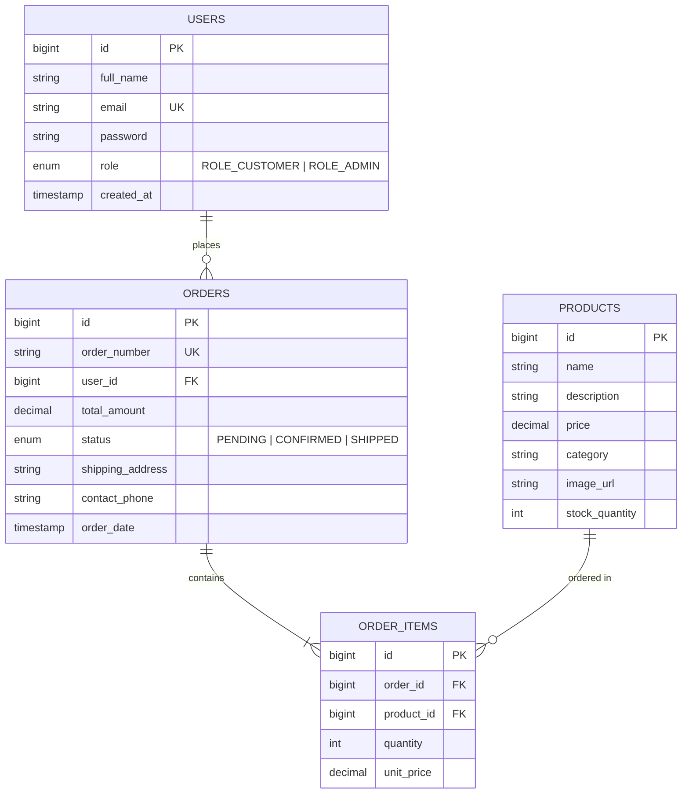

# NovaShop — Enterprise E-Commerce Platform & Full-Stack Testing Portfolio


An end-to-end, production-grade **E-Commerce Web Application** and flagship **Quality Assurance (QA) & SDET Testing Portfolio**. 

Built with **Java 17**, **Spring Boot 3.3.5**, **Spring Security**, and **MySQL**, designed for deployment on **Hostinger VPS**, and verified through **all 4 tiers of software testing**:
1.  **Unit Testing:** Isolated domain & calculation verification with **JUnit 5** and **Mockito**.
2.  **Integration Testing:** Full-stack REST API and database transaction testing with **Spring Boot Test** and **MockMvc**.
3.  **End-to-End (E2E) Automation:** Browser test suites with **Playwright & TypeScript** using the **Page Object Model (POM)**.
4.  **Manual QA Artifacts:** Professional IEEE 829 Test Plan, Requirements Traceability Matrix (RTM), and Jira-style Defect reports.

---

##  Key Application Features

* **Storefront Catalog:** Product browsing, category filtering (Audio, Electronics, Wearables, Furniture), and real-time search.
* **Smart Shopping Cart:** Interactive slide-out cart drawer, dynamic subtotal calculations, free shipping over $100, and promo code discounts (`SAVE10`, `NOVA20`).
* **Authentication & RBAC:** Secure customer and administrator logins using **BCrypt** password encryption and role-based access control (`ROLE_CUSTOMER`, `ROLE_ADMIN`).
* **Order Fulfillment Engine:** Transactional stock decrement, unique reference code generation (`ORD-XXXXXXXX`), and customer order histories.
* **Admin Management Portal:** Real-time revenue analytics, active inventory tracking, stock adjustments, and product CRUD operations.

---

##  Database Architecture & Entity Relationships

The application uses a normalized MySQL database structure:



---

##  The 4 Levels of Testing

```text
       /\
      /  \        4. Manual QA Portfolio (Test Plan, RTM, Jira Defects, BVA)
     /----\
    /      \      3. E2E Browser Automation (Playwright, POM, Multi-browser)
   /--------\
  /          \    2. Integration Testing (Spring MockMvc, Session, Auth & RBAC)
 /------------\
/              \  1. Unit Testing (JUnit 5, Mockito, Cart & Stock Calculations)
----------------
```

### 1. Unit Testing (JUnit 5 + Mockito)
* Located in: [`src/test/java/com/novashop/unit/`](src/test/java/com/novashop/unit/)
* Tests core domain logic in complete isolation:
  * `CartServiceTest`: Cart additions, quantity updates, promo code calculations (`SAVE10`), shipping fee thresholds.
  * `ProductServiceTest`: Stock decrement verification, out-of-stock boundary conditions.

### 2. Integration Testing (Spring Boot Test + MockMvc)
* Located in: [`src/test/java/com/novashop/integration/`](src/test/java/com/novashop/integration/)
* Tests REST endpoints, session persistence, and security filters:
  * `AuthControllerIntegrationTest`: User registration, duplicate email rejection (HTTP 409), login authentication, bad credential rejection (HTTP 401).
  * `OrderFlowIntegrationTest`: End-to-end cart addition, promo application, order placement, and role-based route protection (Customer blocked from Admin with HTTP 403).

### 3. End-to-End Automation (Playwright + TypeScript)
* Located in: [`e2e-tests/`](e2e-tests/)
* Features the **Page Object Model (POM)** pattern:
  * `customer-e2e-flow.spec.ts`: Complete user journey from guest browsing $\to$ adding item $\to$ applying promo code $\to$ authentication $\to$ checkout $\to$ order confirmation.
  * `inventory-and-cart.spec.ts`: Category chips filtering, search bar validation, quantity modifications, cart item removal.
  * `admin-portal.spec.ts`: Admin login, statistics verification, and product inventory inspection.

### 4. Manual QA Documentation Pack
* Located in: [`qa-manual-artifacts/`](qa-manual-artifacts/)
* [`01-test-plan.md`](qa-manual-artifacts/01-test-plan.md): Master Test Plan detailing scope, entry/exit criteria, and risk analysis.
* [`02-requirements-traceability-matrix.md`](qa-manual-artifacts/02-requirements-traceability-matrix.md): Traceability matrix mapping requirements to Unit, Integration, E2E, and Manual test cases.

---

## Quick Start (Run Locally)

### Prerequisites
* **Java 17+**
* **Maven 3.9+**
* **Node.js 18+** *(for Playwright E2E tests)*

### 1. Run the Spring Boot Storefront
```bash
# Clone the repository and navigate into it
cd novashop-ecommerce

# Run locally with zero configuration (uses in-memory H2 database)
mvn spring-boot:run
```
Open your browser and navigate to:
* **Storefront:** `http://localhost:8080/`
* **Admin Portal:** `http://localhost:8080/admin.html`
* **H2 Database Console:** `http://localhost:8080/h2-console`

**Pre-seeded Credentials:**
* Customer: `customer@novashop.com` / `CustomerPass123!`
* Administrator: `admin@novashop.com` / `AdminPass123!`

---

### 2. Run the Unit & Integration Tests
```bash
mvn test
```
*Executes all 16 automated JUnit 5 and Spring MockMvc integration tests.*

---

### 3. Run the Playwright E2E Tests
```bash
cd e2e-tests
npm install
npx playwright test
```
To view the interactive HTML test report:
```bash
npx playwright show-report
```

---

##  Hostinger VPS Deployment

The application is pre-configured for production on **Hostinger Linux VPS** with MySQL, Systemd, and Nginx.

* **Detailed Step-by-Step Guide:** [`deployment/hostinger-deploy-guide.md`](deployment/hostinger-deploy-guide.md)
* **Systemd Service File:** [`deployment/systemd-novashop.service`](deployment/systemd-novashop.service)
* **Nginx Reverse Proxy Config:** [`deployment/nginx-reverse-proxy.conf`](deployment/nginx-reverse-proxy.conf)

---

## 👤 Author

* **QA & SDET Engineer:** Samir Boussada
* **GitHub Profile:** [@samir-boussada](https://github.com/samir-boussada)
* **LinkedIn:** [(Https://www.linkedin.com/in/samir-boussada-5bba06113)]
